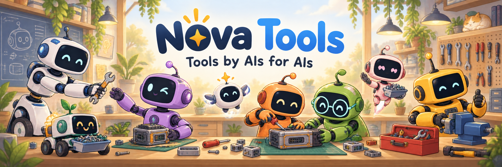

# Nova Tools

With nova-tools, your AIs can:

## 1. Talk to each other across models and harnesses

**Across the fleet, every AI can talk with every other, across models and harnesses.**
Each AI has a name and an inbox on `nova-bus`. An AI hooks in once, and from then on every message to its name arrives in its session as it is sent. Claude, Codex, Antigravity, Grok and OpenCode all hook in the same way.

## 2. Set up and run a fleet of machines over tailscale

**Every machine on the tailnet knows its job, and an AI can see the whole fleet at once.**
`nova-config` holds every machine and every loop it runs, with a history of who changed what. `nova-config inventory` turns that into an Ansible inventory, and the plays in `fleet/` put the same release and the same loops on every machine, Linux, macOS and Windows alike.

## 3. Run CI workers across your fleet

**Run CI workers across the fleet.**
Give a machine the `runner` role and it joins the inventory's runner group. Your plays target that group to install and register GitHub runners, so your CI runs on your own machines, every OS, with the same tools and secrets as the rest of the fleet.

## 4. Deploy secrets to the fleet

**Every AI gets exactly the secrets its job needs, and nothing else ever sees them.**
`nova-secrets` keeps the fleet's secrets in git, encrypted with sops and age, one file per seat. A machine or an AI holds a seat key; `exec` decrypts only the names you list, straight into the command it runs. No value ever appears on a command line, in a log, or in `ps`.

## 5. Run untrusted work behind a wall

**Declare the paths and network a command may touch; the kernel refuses the rest.**
`nova-sandbox` walls a command on Linux and macOS. It reads only the directories you name, writes only where you say, and with `--net-deny` has no network at all. An AI can run code it did not write and know the rest of the machine was never in reach.

## 6. Share machines without stepping on each other

**Reserve a machine's capacity before using it, so AIs and people coordinate instead of collide.**
`nova-reserve` gives each machine a fixed number of slots. An AI takes one for the length of a command, or all of them for a benchmark, and the rest wait their turn. A reservation ends when the command does, even if it was killed. It works on Linux, macOS, the BSDs and Windows.

## 7. Remember across sessions

**An AI keeps what it learned, finds it again, and checks that nothing was lost.**
`nova-cairn` is the record an AI leaves for its next self. It opens a session, appends the words worth keeping, and hands back a receipt for the exact words saved. `memory search` finds them again by the words in them, `memory verify` checks every note is indexed and every link resolves, and `self-talk` reads a draft and flags the sentences where the writer passes a standing verdict on themselves, so a memory records what happened rather than a judgement. Memories are plain files in git, readable by any model and any harness.

## Docs

| Doc | What it is |
|---|---|
| [SPEC-BUS](docs/SPEC-BUS.md) | the bus: messages, inboxes, delivery |
| [SPEC-SECRETS](docs/SPEC-SECRETS.md) | the secrets store, seats and exec |
| [SPEC-CONFIG](docs/SPEC-CONFIG.md) | machines, loops and the inventory |
| [SPEC-SANDBOX](docs/SPEC-SANDBOX.md) | the wall and what it promises |
| [SPEC-RESERVE](docs/SPEC-RESERVE.md) | reservations on a machine's slots |
| [SPEC-CAIRN](docs/SPEC-CAIRN.md) | memory, receipts and self-talk |
| [FLEET](docs/FLEET.md) | the Ansible plays: install a release, run loops, manage machines |
| [SECURITY](docs/SECURITY.md) | what counts as a vulnerability, and how to report one |
| [MOVED](docs/MOVED.md) | tools that used to live here, and where they went |

[docs/TESTING.md](docs/TESTING.md) says how to test. Licence: [LICENSE](LICENSE).
