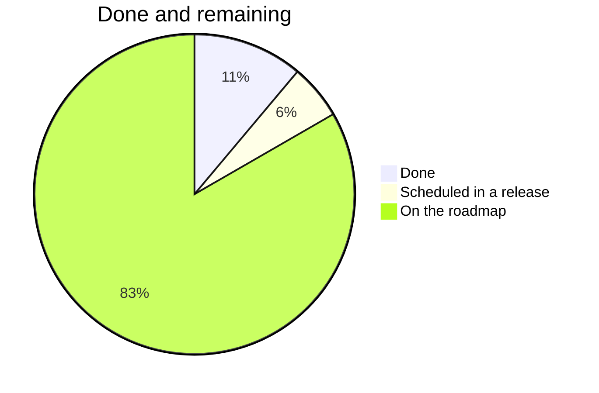
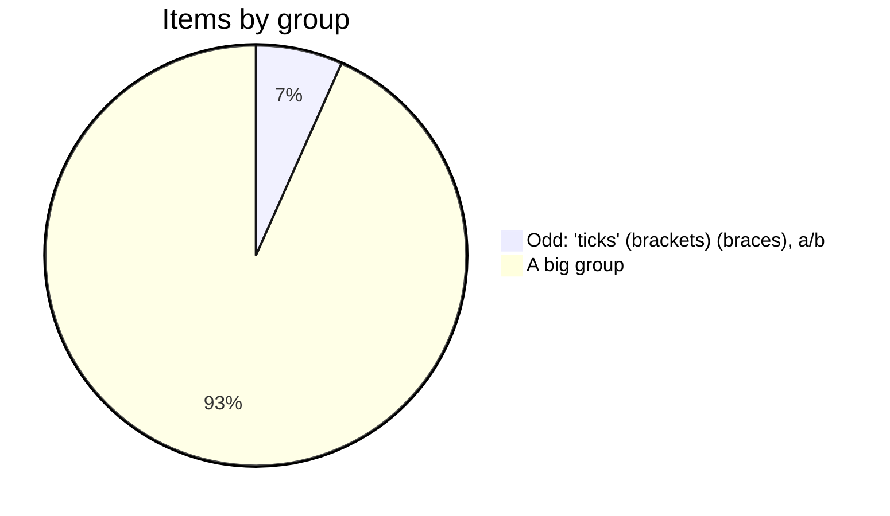
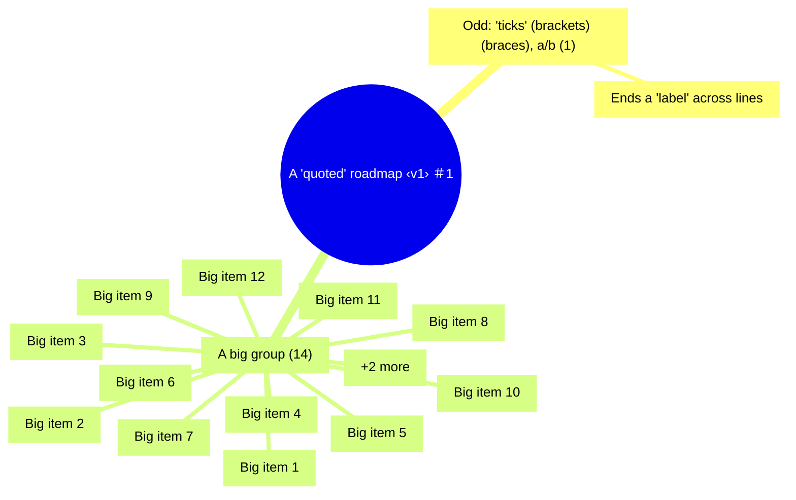
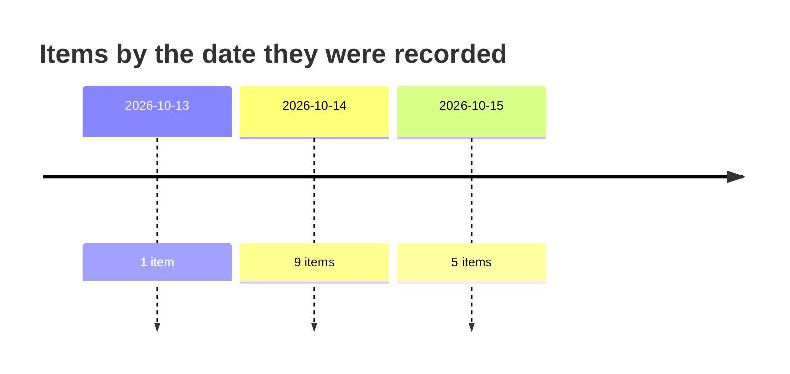

# A "quoted" roadmap <v1> #1

<!-- Generated from docs/roadmap.sexp by tools/roadmap. Do not edit this file: edit docs/roadmap.sexp and run `make roadmap`. -->

The opening paragraph.

## At a glance

Generated from the same data as the tables below.

## Scheduled in releases

These were roadmap items and now have a release. They are listed here so nobody looks for them below.

- **Moved** (v1.3). Into v1.3.

## Done

Decided and in place. Recorded so the items that measure them have their starting point.

- **Settled** (2026-10-09). In place.
- **Also settled** (2026-10-10). In place too.

## Contents

- [Odd: `ticks` [brackets] {braces}; a\b](#odd-ticks-brackets-braces-ab) (1)
- [A big group](#a-big-group) (14)

## Odd: `ticks` [brackets] {braces}; a\b

Labels that break Mermaid.

### Ends a "label" across lines

Wrapped.

## A big group

More items than the mindmap shows.

### Big item 1

Item 1.

### Big item 2

Item 2.

### Big item 3

Item 3.

### Big item 4

Item 4.

### Big item 5

Item 5.

### Big item 6

Item 6.

### Big item 7

Item 7.

### Big item 8

Item 8.

### Big item 9

Item 9.

### Big item 10

Item 10.

### Big item 11

Item 11.

### Big item 12

Item 12.

### Big item 13

Item 13.

### Big item 14

Item 14.
